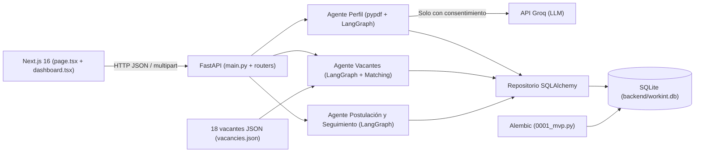

> **Demostración actual:** consultar [Guía de escenarios](docs/demo_escenarios/GUIA_DEMOSTRACION.md). Usa `workint_escenarios.db`, 10 vacantes y el nuevo estado final `contratado`. El resto de este README conserva la descripción de Entrega 2.

# WORKINT · Profile Manager — Entrega 2 (MVP Consolidado y Auditado)

Sistema agéntico local desarrollado para el reto de **Magneto (Idea 2: Arquitectura agéntica con LangGraph)** en la asignatura de Ingeniería de Software. Implementa la gestión integral del perfil profesional del candidato, recomendación determinista y explicable sobre 18 vacantes ficticias, postulación simulada con confirmación explícita, seguimiento automático por reglas de estado y panel de trazabilidad de agentes.

> **Aviso de alcance y privacidad:** Este MVP opera exclusivamente en `localhost` con datos ficticios y postulaciones simuladas. No realiza scraping, no envía datos a Magneto ni a empresas reales, y exige consentimiento explícito antes de enviar el texto de un CV de prueba al proveedor externo de IA (Groq).

---

## Índice

1. [Resumen de todo lo realizado (Implementación, Auditoría y Consolidación)](#1-resumen-de-todo-lo-realizado-implementación-auditoría-y-consolidación)
2. [Arquitectura y Agentes LangGraph](#2-arquitectura-y-agentes-langgraph)
3. [Estructura del Proyecto](#3-estructura-del-proyecto)
4. [Modelo de Datos y Persistencia (SQLite + Alembic)](#4-modelo-de-datos-y-persistencia-sqlite--alembic)
5. [Reglas de Negocio: Matching, Estados y Seguimiento](#5-reglas-de-negocio-matching-estados-y-seguimiento)
6. [Endpoints de la API REST (FastAPI)](#6-endpoints-de-la-api-rest-fastapi)
7. [Cobertura Académica de Historias de Usuario (81,82 %)](#7-cobertura-académica-de-historias-de-usuario-8182-)
8. [Pruebas Automatizadas y Verificación E2E (47/47 aprobadas)](#8-pruebas-automatizadas-y-verificación-e2e-4747-aprobadas)
9. [Guía de Instalación y Ejecución Paso a Paso](#9-guía-de-instalación-y-ejecución-paso-a-paso)
10. [Documentación Detallada de Entrega 2](#10-documentación-detallada-de-entrega-2)
11. [Anexo Histórico: Prueba de Concepto Inicial (PoC)](#workint---prueba-de-concepto-poc)

---

## 1. Resumen de todo lo realizado (Implementación, Auditoría y Consolidación)

### 1.1. Auditoría y sincronización entre carpetas (`WORKINT` vs. `WORKIN1`)
Durante el desarrollo previo se habían utilizado dos rutas locales en `~/Documentos/ChatGPT/`:
- **`WORKINT/Proyecto-ing-Software` (Ruta principal):** contenía únicamente el avance inicial (carga de PDF, extracción de texto con `pypdf` y extracción básica de perfil con Groq sin base de datos, con 26 pruebas).
- **`WORKIN1/Proyecto-ing-Software` (Copia de trabajo):** contenía el cierre completo del MVP (modelos SQLAlchemy, migración Alembic, CRUD de perfiles, dataset de 18 vacantes, matching determinista, postulación simulada, seguimiento, panel de trazabilidad, interfaz completa en Next.js, 47 pruebas y documentación de Entrega 2).

**Acciones ejecutadas en la auditoría:**
1. Se creó una **copia de seguridad completa** del estado previo de `WORKINT/Proyecto-ing-Software` antes de tocar cualquier archivo.
2. Se compararon archivo por archivo (`diff -rq` y `diff -u`) ambas carpetas, verificando que `WORKIN1` era una continuación directa sobre el mismo commit base (`80b347b` en la rama `desarrollo/entrega-2`).
3. Se conservaron todos los archivos locales preexistentes del usuario en `WORKINT` (`backend/.env`, los 6 archivos PDF previos en `backend/uploads/` y `backend/app/services/__init__.pyC`).
4. Se **sincronizaron de forma selectiva hacia la carpeta principal `WORKINT/Proyecto-ing-Software`** los **9 archivos modificados** y los **32 archivos nuevos** de código, migraciones, pruebas y documentación, además de la base de datos de demostración `backend/workint.db` y el PDF ficticio asociado (`0e4e022a3d1545b39e0b86ba1b9a8ebd.pdf`), sin copiar `.venv`, `node_modules` ni `.next`.

### 1.2. Correcciones técnicas aplicadas en la consolidación
1. **Resolución de conflicto de dependencias en `backend/requirements.txt`:**
   - El archivo `backend/requirements.txt` declaraba `websockets==17.2` junto con `langgraph==1.2.14` (cuyo subpaquete `langgraph-sdk` requiere `websockets<17.0`). Esto provocaba que `pip install -r requirements.txt -r requirements-dev.txt` fallara por backtracking infinito (`error: resolution-too-deep`).
   - Se corrigió la línea en `backend/requirements.txt` a `websockets==16.1.1` (versión compatible e instalada en el entorno) y se instalaron `SQLAlchemy==2.0.54`, `alembic==1.20.0`, `greenlet`, `Mako` y `MarkupSafe` en `WORKINT/Proyecto-ing-Software/backend/.venv`.
2. **Alineación documental con las plantillas académicas:**
   - Se verificaron las plantillas `Entrega2_Template_HistoriasUsuario(1).xlsx` y `Entrega2_Template_Arquitectura(1).docx`.
   - Se amplió `docs/entrega2/ARQUITECTURA.md` con las secciones explícitas exigidas por la plantilla Word (estilos arquitectónicos, lenguajes, aspectos técnicos, frameworks y árbol de directorios consolidado) y se actualizaron `DEMO.md`, `ESTADO_INICIAL.md` y `PRUEBAS.md` para reflejar la consolidación en `WORKINT`.

### 1.3. Módulos funcionales implementados y verificados
- **Módulo de Perfil Profesional (`Agente de Perfil`):**
  - Carga de CV en PDF (validación de extensión `.pdf`, firma `%PDF-`, tamaño máximo 5 MB, hasta 10 páginas y 20.000 caracteres).
  - Extracción estructurada mediante **LangGraph** (`extract → validate`) y **Groq** (`openai/gpt-oss-20b` con `json_schema`), bloqueada hasta recibir consentimiento booleano estricto (`consent_external_processing: true`).
  - Detección automática de campos faltantes/desconocidos (`profile_gaps.py`) clasificados en `recomendado` y `opcional` (tratando `0` años de experiencia como dato válido, nunca como vacío).
  - CRUD completo de perfiles en SQLite (`POST`, `GET`, `PUT`, `DELETE /api/v1/profiles`), soporte de creación manual (`source = "manual"`), edición de perfiles extraídos (`source = "groq_editado"`) y protección de correcciones manuales frente a reintentos de extracción del mismo PDF.
- **Módulo de Vacantes y Recomendaciones (`Agente de Vacantes`):**
  - Dataset curado de **18 vacantes ficticias** (`backend/app/data/vacancies.json`, `demo-01` a `demo-18`), incluyendo casos con salario desconocido (`demo-15`) y experiencia `0` (`demo-09`, `demo-18`).
  - Ingesta atómica e idempotente (`vacancies.py`) con normalización de habilidades y modalidades.
  - Grafo **LangGraph** (`normalizar → matching`) con algoritmo determinista explicable por pesos fijos (**45 % habilidades, 20 % cargo, 15 % modalidad, 10 % ubicación, 10 % salario**), donde los criterios desconocidos aportan `0` puntos sin redistribuir pesos.
- **Módulo de Postulación Simulada (`Agente de Postulación`):**
  - Grafo **LangGraph** (`consentimiento → simular → seguimiento`) que exige confirmación booleana estricta (`confirmed: true`), bloquea postulaciones duplicadas por `(candidate_id, vacancy_id)` con HTTP `409` y persiste evidencia auditable (`operation_id`, fecha UTC, tipo `"simulada"`, resultado `"registrada_localmente"`).
  - Máquina de estados finita (`postulado`, `en_revision`, `entrevista`, `descartado`) con validación estricta de transiciones permitidas.
- **Módulo de Seguimiento (`Agente de Seguimiento`):**
  - Reglas automáticas por estado que generan el próximo paso sugerido y actualizan un recordatorio local único por postulación (`reminders`), cerrándolo (`pending = false`) cuando el proceso pasa a `descartado`.
- **Panel de Trazabilidad (`agent_logs`) e Interfaz Web (Next.js + TypeScript):**
  - Registro cronológico de todas las decisiones de los 4 agentes (`perfil`, `vacantes`, `postulacion`, `seguimiento`) con su justificación (`reason`) y referencia (`result_ref`).
  - Interfaz completa en `frontend/src/app/page.tsx` y `frontend/src/app/dashboard.tsx` para ejecutar todo el recorrido de extremo a extremo.

---

## 2. Arquitectura y Agentes LangGraph

El sistema sigue una arquitectura **Cliente/Servidor** y **Monolito Modular en Capas (Layered / N-Tiers)**:



### Flujo de los Grafos LangGraph
1. **Grafo de Perfil (`build_profile_graph` en `profile_extractor.py`):**
   - `START → extract → validate → END`
2. **Grafo de Vacantes (`build_vacancy_graph` en `vacancies.py`):**
   - `START → normalizar → matching → END`
3. **Grafo de Postulación y Seguimiento (`build_application_graph` en `applications.py`):**
   - `START → consentimiento → simular → seguimiento → END`
   - En cambios manuales de estado (`PATCH /api/v1/applications/{id}`): `START → seguimiento → END`

---

## 3. Estructura del Proyecto

```text
Proyecto-ing-Software/
├── README.md                                # Este documento general del proyecto
├── main.py                                  # Script de la PoC inicial (conservado)
├── backend/
│   ├── alembic.ini                          # Configuración de Alembic
│   ├── main.py                              # Punto de entrada FastAPI, CORS, upload y extracción CV
│   ├── requirements.txt                     # Dependencias de producción fijadas
│   ├── requirements-dev.txt                 # Dependencias de pruebas (pytest, httpx, reportlab)
│   ├── workint.db                           # Base de datos SQLite local (ignorada en Git)
│   ├── alembic/
│   │   ├── env.py                           # Entorno de migración conectado a SQLAlchemy
│   │   └── versions/
│   │       └── 0001_mvp.py                  # Migración inicial (6 tablas relacionales)
│   ├── app/
│   │   ├── database.py                      # Motor SQLAlchemy (PRAGMA foreign_keys=ON) y get_db
│   │   ├── repository.py                    # Guardado de perfiles y registro en agent_logs
│   │   ├── api/
│   │   │   ├── profiles.py                  # CRUD de perfiles (/api/v1/profiles)
│   │   │   └── workflow.py                  # Vacantes, recomendaciones, postulaciones, recordatorios, actividad
│   │   ├── data/
│   │   │   └── vacancies.json               # Dataset de 18 vacantes ficticias (demo-01 a demo-18)
│   │   ├── models/
│   │   │   ├── candidate_profile.py         # Esquemas Pydantic CandidateProfile, WorkExperience, Education, JobPreferences
│   │   │   ├── contracts.py                 # Contratos Pydantic de peticiones y respuestas HTTP
│   │   │   └── entities.py                  # Modelos ORM SQLAlchemy (Candidate, Profile, Vacancy, Application, Reminder, AgentLog)
│   │   └── services/
│   │       ├── pdf_extractor.py             # Extracción y validación local de texto PDF con pypdf
│   │       ├── profile_extractor.py         # Agente de Perfil (LangGraph + ChatGroq)
│   │       ├── profile_gaps.py              # Detección de campos faltantes recomendados y opcionales
│   │       ├── vacancies.py                 # Agente de Vacantes (ingesta idempotente + LangGraph)
│   │       ├── matching.py                  # Motor determinista de puntuación (pesos 45/20/15/10/10)
│   │       └── applications.py              # Agentes de Postulación y Seguimiento (LangGraph + estados)
│   └── tests/
│       ├── conftest.py                      # Fixture autouse con SQLite temporal migrada con Alembic por test
│       ├── test_upload.py                   # 6 pruebas de carga y validación de archivos PDF
│       ├── test_pdf_extractor.py            # 4 pruebas unitarias del extractor pypdf
│       ├── test_extract_api.py              # 3 pruebas del endpoint de extracción de texto
│       ├── test_candidate_profile.py        # 5 pruebas de validación Pydantic de CandidateProfile
│       ├── test_profile_extractor.py        # 3 pruebas del grafo de extracción de perfil
│       ├── test_profile_api.py              # 5 pruebas de consentimiento, extracción y errores de IA
│       ├── test_persistence.py              # 4 pruebas de CRUD, migraciones, reconexión y brechas (gaps)
│       └── test_workflow.py                 # 17 pruebas de ingesta, matching, confirmación, estados, recordatorios, CORS e integración E2E
├── frontend/
│   ├── package.json                         # Next.js 16.4.0, React 19.3.0, Tailwind CSS 4, TypeScript 5
│   └── src/app/
│       ├── layout.tsx                       # Layout raíz en español sin dependencia de fuentes externas
│       ├── globals.css                      # Estilos globales y utilidades de paneles/botones
│       ├── page.tsx                         # Paso 1 y 2: Carga de PDF y consentimiento para Groq
│       ├── dashboard.tsx                    # Editor CRUD de perfil, ranking, modal de postulación, seguimiento y trazabilidad
│       └── profile-types.ts                 # Tipos TypeScript del perfil profesional
└── docs/entrega2/                           # Documentación técnica y evidencias de Entrega 2
    ├── ESTADO_INICIAL.md
    ├── ALCANCE_MVP.md
    ├── MATRIZ_AVANCE.md
    ├── ARQUITECTURA.md
    ├── PRUEBAS.md
    ├── DEMO.md
    ├── PENDIENTES.md
    └── evidencias/
        ├── backlog_github.json
        ├── pytest.txt
        ├── reinicio.json
        ├── confirmacion.png
        ├── recorrido_groq.png
        └── seguimiento.png
```

---

## 4. Modelo de Datos y Persistencia (SQLite + Alembic)

El esquema relacional es creado exclusivamente mediante Alembic (`0001_mvp.py`) con integridad referencial activa (`PRAGMA foreign_keys=ON`):

| Tabla | Clave Primaria | Claves Foráneas / Restricciones Únicas | Propósito |
|---|---|---|---|
| `candidates` | `id` (`String(32)`) | — | Entidad raíz del candidato |
| `profiles` | `id` (`String(32)`) | `candidate_id` (`UNIQUE`, `CASCADE`), `document_id` (`UNIQUE`) | Datos estructurados del perfil (`JSON`) y origen (`groq`, `groq_editado`, `manual`) |
| `vacancies` | `id` (`String(32)`) | — | Catálogo de vacantes normalizadas (`demo-01` .. `demo-18`) |
| `applications` | `id` (`String(32)`) | `candidate_id` (`CASCADE`), `vacancy_id`, `UNIQUE(candidate_id, vacancy_id)` | Postulaciones simuladas, estado actual y evidencia (`JSON`) |
| `reminders` | `id` (`String(32)`) | `application_id` (`UNIQUE`, `CASCADE`) | Recordatorio local asociado a cada postulación (`due_at`, `message`, `pending`) |
| `agent_logs` | `id` (`String(32)`) | `candidate_id` (`CASCADE`), `application_id` (`CASCADE`) | Bitácora auditable de eventos de los 4 agentes |

---

## 5. Reglas de Negocio: Matching, Estados y Seguimiento

### 5.1. Regla de Matching Determinista (Pesos Fijos)
$$\text{Puntaje Total} = \sum_{c} \text{ redondear}(\text{peso}_c \times \text{fracción}_c, 2)$$

| Criterio | Peso | Regla de cálculo | Comportamiento ante dato desconocido |
|---|---:|---|---|
| **Habilidades (`skills`)** | **45 %** | $\|\text{habilidades\_candidato} \cap \text{requeridas}\| / \|\text{requeridas}\|$ (normalizado sin tildes/mayúsculas) | Aporta `0` puntos (`known = false`), **sin redistribuir el peso** |
| **Cargo (`role`)** | **20 %** | Tokens coincidentes del título de la vacante en el cargo objetivo o cargos deseados (con alias `developer`/`desarrollador`, `engineer`/`ingeniero`) | Aporta `0` puntos (`known = false`), **sin redistribuir el peso** |
| **Modalidad (`work_mode`)** | **15 %** | `1.0` si la modalidad de la vacante está entre las modalidades preferidas del candidato; `0.0` en caso contrario | Aporta `0` puntos (`known = false`), **sin redistribuir el peso** |
| **Ubicación (`location`)** | **10 %** | `1.0` si la vacante es `remoto` o si la ciudad coincide con las ubicaciones preferidas (o ciudad de residencia si no definió preferidas) | Aporta `0` puntos (`known = false`), **sin redistribuir el peso** |
| **Salario (`salary`)** | **10 %** | `1.0` si existe intersección entre el rango salarial del candidato y el de la vacante en COP; `0.0` si no se intersectan | Aporta `0` puntos (`known = false`), **sin redistribuir el peso** |

### 5.2. Máquina de Estados y Reglas de Seguimiento

| Estado actual | Transiciones permitidas | Próximo paso generado por el Agente de Seguimiento | Vencimiento del recordatorio | `pending` |
|---|---|---|---|---|
| `postulado` | `en_revision`, `descartado` | `"Revisar el proceso simulado en 3 días"` | `+3 días` | `true` |
| `en_revision` | `entrevista`, `descartado` | `"Preparar ejemplos de experiencia para una posible entrevista"` | `+2 días` | `true` |
| `entrevista` | `descartado` | `"Preparar entrevista; la fecha real no está programada"` | `+1 día` | `true` |
| `descartado` | *(Ninguna — estado terminal)* | `"Proceso finalizado; revisar otras vacantes"` | `+0 días` | `false` |

---

## 6. Endpoints de la API REST (FastAPI)

Documentación interactiva OpenAPI disponible en `/docs`:

- `GET /health` — Estado del servicio.
- `POST /api/v1/cv/upload` — Carga y validación de archivo PDF (`201 Created`).
- `POST /api/v1/cv/{document_id}/extract` — Extracción local de texto del PDF (`200 OK`).
- `POST /api/v1/cv/{document_id}/profile` — Extracción estructurada con Groq y guardado inicial (`200 OK`; exige `{"consent_external_processing": true}`).
- `POST /api/v1/profiles` — Creación manual de perfil (`201 Created`).
- `GET /api/v1/profiles` — Listado de perfiles persistidos (`200 OK`).
- `GET /api/v1/profiles/{candidate_id}` — Detalle de perfil y campos faltantes (`200 OK`).
- `PUT /api/v1/profiles/{candidate_id}` — Actualización completa del perfil y recálculo de faltantes (`200 OK`).
- `DELETE /api/v1/profiles/{candidate_id}` — Eliminación en cascada del candidato, su perfil, postulaciones, recordatorios y trazas (`204 No Content`).
- `GET /api/v1/vacancies` y `GET /api/v1/vacancies/{vacancy_id}` — Consulta del catálogo de 18 vacantes (`200 OK`).
- `GET /api/v1/profiles/{candidate_id}/recommendations` — Ranking de las 18 vacantes con desglose de puntaje y registro de traza (`200 OK`).
- `POST /api/v1/applications` — Ejecución de postulación simulada (`201 Created`; exige `{"confirmed": true}` estricto; `409 Conflict` si está duplicada).
- `PATCH /api/v1/applications/{application_id}` — Cambio manual de estado y actualización automática de seguimiento (`200 OK`; `409 Conflict` si la transición es inválida).
- `GET /api/v1/profiles/{candidate_id}/applications` — Historial de postulaciones y evidencias del candidato (`200 OK`).
- `GET /api/v1/profiles/{candidate_id}/reminders` — Recordatorios asociados a las postulaciones del candidato (`200 OK`).
- `GET /api/v1/profiles/{candidate_id}/activity` — Historial cronológico de acciones y justificaciones de los 4 agentes (`200 OK`).

---

## 7. Cobertura Académica de Historias de Usuario (81,82 %)

Sobre las **22 historias originales del backlog en GitHub** (20 funcionales y 2 no funcionales), utilizando ponderación uniforme (`peso = 1`) y contabilizando únicamente las historias 100 % demostrables (`DONE técnica`):

- **Cobertura técnica propuesta:** **18 / 22 = 81,82 %** *(pendiente de validación académica y aceptación formal del Product Owner; supera el mínimo del 60 % exigido para la Entrega 2)*.
- **18 Historias `DONE técnica`:** `HU01`, `HU02`, `HU03`, `HU04`, `HU05`, `HU06`, `HU09`, `HU10`, `HU11`, `HU12`, `HU13`, `HU14`, `HU15`, `HU16`, `HU17`, `HU18`, `HU19`, `HU20`.
- **4 Historias `PARTIAL` (0 % atribuido al numerador):**
  - `HU07`: Normaliza vacantes y preserva `null` en datos faltantes, pero no genera un reporte separado de faltantes durante la importación.
  - `HU08`: Pondera y ordena según preferencias, pero no excluye del listado las vacantes incompatibles.
  - `HU-NF01`: Valida entradas, exige consentimiento para Groq y restringe CORS, pero no incluye autenticación multiusuario ni borrado automático de PDFs.
  - `HU-NF02`: Controla excepciones conocidas con mensajes claros y ruta manual, pero carece de logging centralizado de fallos técnicos.

---

## 8. Pruebas Automatizadas y Verificación E2E (47/47 aprobadas)

### Suite automatizada (Backend y Frontend)
- **Pytest (`backend/tests/`):** **47 pruebas ejecutadas, 47 aprobadas, 0 fallidas**. Cada prueba crea su propia base SQLite temporal en disco migrada con Alembic (`conftest.py`) y aísla las llamadas externas mediante mocks/modelos falsos.
- **Compilación Python (`compileall`):** Aprobada sin errores.
- **TypeScript (`npx tsc --noEmit`):** Aprobado sin errores.
- **Linter (`npm run lint`):** Aprobado sin advertencias ni errores.
- **Build de producción (`npm run build`):** Compilación exitosa en Next.js 16.4.0.

---

## 9. Guía de Instalación y Ejecución Paso a Paso

### Requisitos previos
- **Python:** 3.10+ (verificado en Python 3.14.7)
- **Node.js:** 20+ (verificado en Node 22.23.1 y npm 10.9.8)
- **Variables de entorno (opcional para extracción con IA):** crear `backend/.env` con:
  ```dotenv
  GROQ_API_KEY=tu_clave_local_de_groq
  GROQ_MODEL=openai/gpt-oss-20b
  ```
  *(Si `GROQ_API_KEY` no está configurada o el proveedor no está disponible, el sistema informa el error de forma controlada y permite usar el flujo completo mediante **Crear perfil manual**).*

### Paso 1: Preparar e iniciar el Backend (FastAPI)

Desde la carpeta principal `/home/r347/Documentos/ChatGPT/WORKINT/Proyecto-ing-Software`:

```bash
cd /home/r347/Documentos/ChatGPT/WORKINT/Proyecto-ing-Software/backend
python3 -m venv .venv
./.venv/bin/python -m pip install -r requirements.txt -r requirements-dev.txt
./.venv/bin/python -m alembic upgrade head
./.venv/bin/python -m app.services.vacancies
./.venv/bin/python -m pytest -q
```

Para iniciar el servidor en el puerto por defecto (`8000`):
```bash
./.venv/bin/python -m uvicorn main:app --host 127.0.0.1 --port 8000
```
*(O en el puerto alternativo `8001` si el `8000` está ocupado)*:
```bash
./.venv/bin/python -m uvicorn main:app --host 127.0.0.1 --port 8001
```

### Paso 2: Preparar e iniciar el Frontend (Next.js)

En otra terminal:
```bash
cd /home/r347/Documentos/ChatGPT/WORKINT/Proyecto-ing-Software/frontend
npm ci
```

Si el backend corre en `8000` (puerto por defecto `3000`):
```bash
npm run dev -- --hostname 127.0.0.1 --port 3000
```
*(Si el backend corre en `8001` y deseas usar el puerto alternativo `3001`)*:
```bash
NEXT_PUBLIC_API_URL=http://127.0.0.1:8001 npm run dev -- --hostname 127.0.0.1 --port 3001
```

---

## 10. Documentación Detallada de Entrega 2

- [Guion de demostración y ejecución (`docs/entrega2/DEMO.md`)](docs/entrega2/DEMO.md)
- [Matriz de avance de las 22 historias (`docs/entrega2/MATRIZ_AVANCE.md`)](docs/entrega2/MATRIZ_AVANCE.md)
- [Arquitectura, contratos y 5 diagramas Mermaid (`docs/entrega2/ARQUITECTURA.md`)](docs/entrega2/ARQUITECTURA.md)
- [Alcance y fronteras del MVP (`docs/entrega2/ALCANCE_MVP.md`)](docs/entrega2/ALCANCE_MVP.md)
- [Auditoría del estado inicial y consolidación (`docs/entrega2/ESTADO_INICIAL.md`)](docs/entrega2/ESTADO_INICIAL.md)
- [Reporte de las 47 pruebas y evidencias (`docs/entrega2/PRUEBAS.md`)](docs/entrega2/PRUEBAS.md)
- [Pendientes técnicos y evidencias Scrum del equipo (`docs/entrega2/PENDIENTES.md`)](docs/entrega2/PENDIENTES.md)

---

## Uso actualizado de la aplicación web — 2026-10-13

La aplicación actual es `frontend/` (Next.js, puerto 3000) con `backend/main.py` (FastAPI, puerto 8000). El `main.py` de la raíz es un prototipo separado; no es necesario ejecutarlo para usar la web. Los componentes actuales son **flujos LangGraph y reglas**, no agentes autónomos; la denominación «agente» de apartados históricos no implica autonomía.

- Al guardar perfil/preferencias se indica progreso, éxito o error. El perfil guardado se muestra en lectura; usa **Editar** para cambiarlo. Un error conserva el borrador. El salario mínimo no puede superar el máximo; el teléfono admite prefijo internacional como texto.
- El aviso general identifica el entorno de demostración. Los textos de presentación no cambian los datos del matching.
- Cada vacante representa un puesto por simulación. Al contratar queda ocupada y no admite nuevas postulaciones. **Contratados y simulaciones** muestra candidato, vacante y fecha registrada; una fecha histórica desconocida se indica como tal.
- **Iniciar nueva simulación** requiere confirmación. Libera las vacantes para la nueva simulación y conserva las postulaciones, recordatorios e historial anteriores en lectura. No reinicia bases ni perfiles.
- **Actividad de componentes y flujos** muestra la operación y el contexto de ejecución. `source=groq` no acredita por sí solo una llamada real. Modelo efectivo e ID del proveedor solo se muestran si se recibieron; los registros anteriores no se completan por inferencia.

Para actualizar instalaciones existentes, aplicar **solo las migraciones**, sin repetir la ingesta ni crear una base nueva. Desde `backend/`, elegir explícitamente cada base existente:

```bash
WORKINT_SCENARIOS=0 WORKINT_DATABASE_URL=sqlite:///workint.db .venv/bin/python -m alembic upgrade head
WORKINT_SCENARIOS=1 WORKINT_DATABASE_URL=sqlite:///workint_escenarios.db .venv/bin/python -m alembic upgrade head
```

Las revisiones nuevas son `0002` (simulaciones) y `0003` (trazabilidad). El estado de ejecución, las verificaciones **de esta versión**, las copias y los pendientes están en [README_AVANCES.md](README_AVANCES.md). Los informes de pruebas anteriores conservan su carácter histórico.

# WorkInt - Prueba de Concepto (PoC), separada de la web actual

## Descripción
En esta prueba de concepto, se realiza una demostración del flujo del sistema. Un agente de inteligencia artificial recibe como entrada un prompt predeterminado, donde un desarrollador pide ayuda para poner su aspiración salarial en su perfil.
En la etapa de proceso, un grafo de estados creado con LangGraph recibe y mantiene el contexto que se comparte entre agentes.
En la salida, el agente aconseja al usuario para escoger un rango salarial adecuado.

El fin de esta prueba de concepto es estabilizar un ambiente de desarrollo y familiarizar al equipo con las tecnologías más fundamentales de nuestro proyecto. Principalmente LangGraph, LangChain y el uso de LLMs.


## Dependencias
El proyecto requiere Python 3.10 o superior y las siguientes librerias:
- langgraph
- langchain-groq
- python-dotenv

## Uso

1. Crear y activar el entorno virtual:
   En Windows:
   python -m venv venv
   .\venv\Scripts\activate
   
   En Linux o macOS:
   python -m venv venv
   source venv/bin/activate

2. Instalar dependencias:
   pip install langgraph langchain-groq python-dotenv

3. Configurar variables de entorno:
   Cree un archivo .env en la raiz del proyecto (al mismo nivel que main.py) con su credencial de la API:
   GROQ_API_KEY="insertar_api_key"

4. Ejecutar la prueba:
   python main.py
