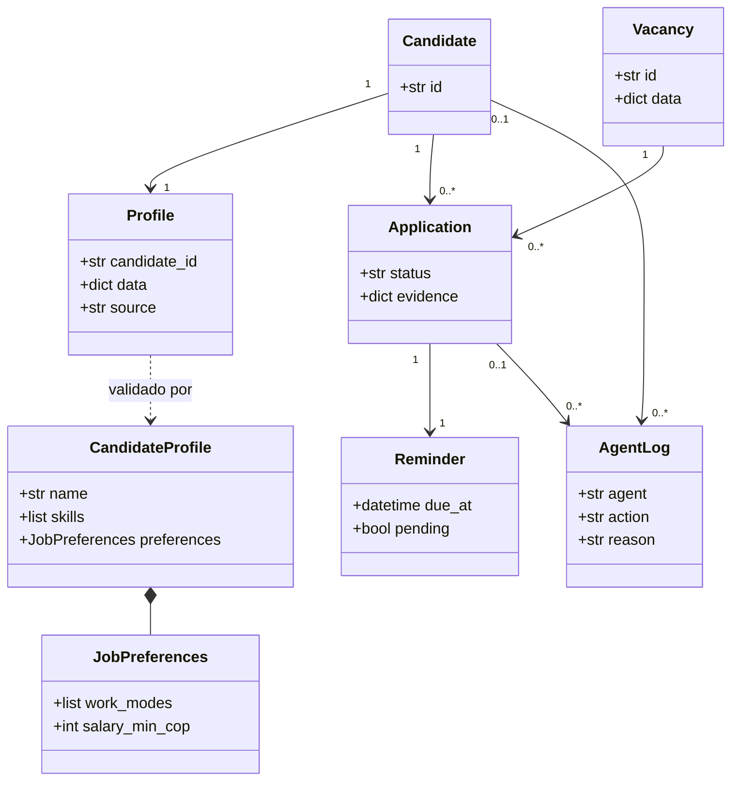
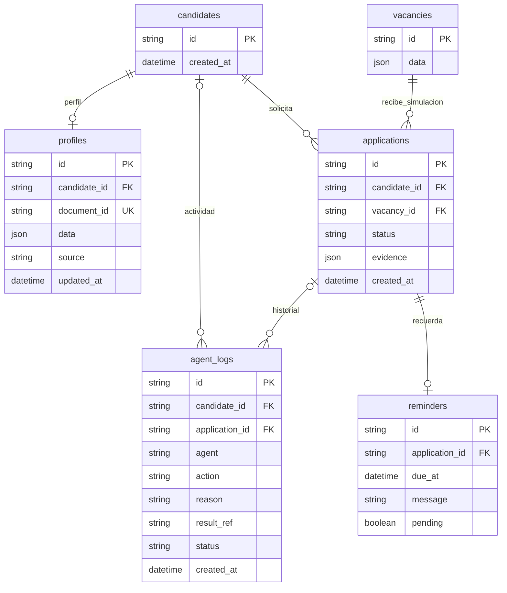
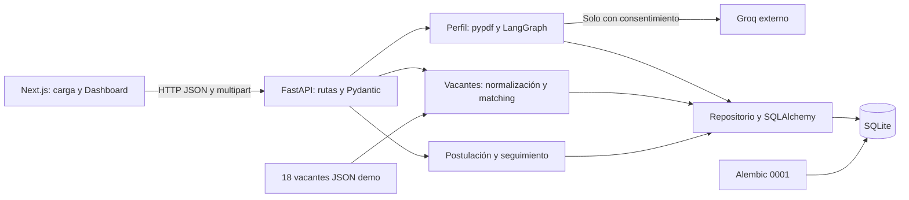
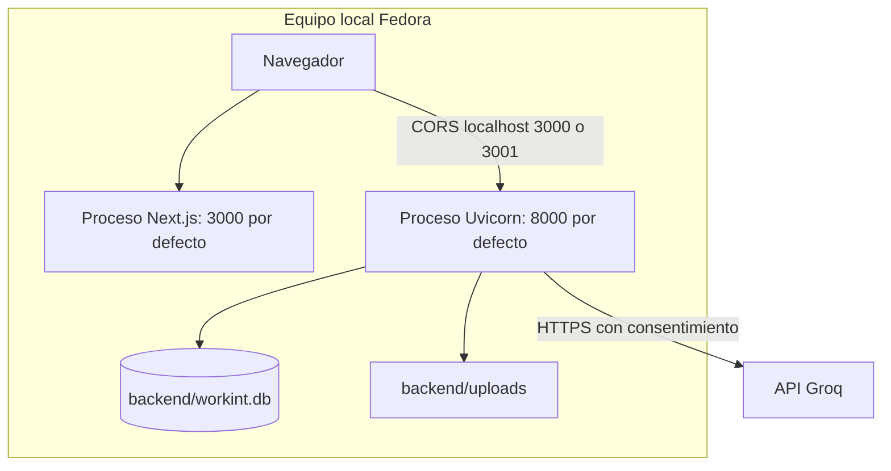
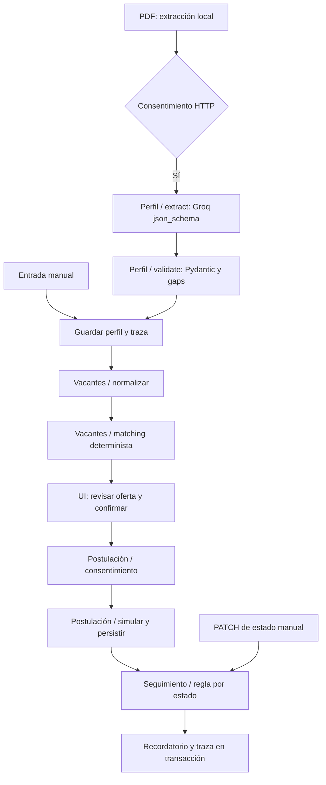

# Arquitectura implementada

Aplicación web cliente/servidor y monolito modular: Next.js presenta formularios y consume FastAPI. La API valida contratos Pydantic y controla consentimiento. Servicios implementan reglas y grafos. SQLAlchemy persiste en SQLite; Alembic crea el esquema. No hay microservicios, autenticación ni conexión a Magneto.

## Responsabilidades y archivos

| Componente | Implementación | Responsabilidad |
|---|---|---|
| Carga y extracción | backend/main.py y services/pdf_extractor.py | Validar PDF, extraer texto, consentimiento antes de Groq |
| Perfil | models/candidate_profile.py, services/profile_extractor.py, profile_gaps.py | Estructurar con grafo existente, validar y detectar vacíos |
| Repositorio de perfiles | app/repository.py y api/profiles.py | Crear candidato/perfil, leer, actualizar, eliminar; registrar origen |
| Vacantes | services/vacancies.py, matching.py, data/vacancies.json | Validar dataset, upsert idempotente, normalizar y ordenar |
| Postulación | services/applications.py, api/workflow.py | Grafo con consentimiento, simulación, evidencia y seguimiento |
| Persistencia | database.py, models/entities.py, alembic/ | Motor, tablas y migración versionada |
| Interfaz | page.tsx, dashboard.tsx, profile-types.ts | Carga existente más edición, ranking y trazabilidad |

Los endpoints coordinan la transacción. Los servicios hacen flush; el commit ocurre al completar la operación. Si la postulación falla no queda un recordatorio huérfano. Las relaciones tienen claves foráneas activadas en SQLite. La base usa JSON para el agregado de perfil y datos de vacante, evitando normalización prematura de campos variables; candidatos, procesos, recordatorios y trazas son entidades relacionales separadas.

Una sola sesión corresponde a cada petición; no se comparte entre solicitudes. La restricción única `(candidate_id, vacancy_id)` protege frente a duplicados además de la comprobación de negocio. El reintento de extracción para el mismo documento devuelve el perfil guardado y no pisa correcciones. Se conserva `groq`, `groq_editado` o `manual` como origen.

## Contratos principales

| Método | Ruta | Resultado |
|---|---|---|
| GET | /health | Estado de proceso (no diagnostica migraciones) |
| POST | /api/v1/cv/upload | Documento PDF local |
| POST | /api/v1/cv/{document_id}/extract | Texto extraído localmente |
| POST | /api/v1/cv/{document_id}/profile | Perfil de Groq guardado; exige bool estricto de consentimiento |
| POST / GET | /api/v1/profiles | Crear manual / listar guardados |
| GET / PUT / DELETE | /api/v1/profiles/{candidate_id} | Consultar / reemplazar datos / eliminar agregado |
| GET | /api/v1/vacancies y /vacancies/{vacancy_id} | Listado y detalle desde BD |
| GET | /api/v1/profiles/{candidate_id}/recommendations | Ranking y evento de agente |
| POST | /api/v1/applications | Simulación con `confirmed: true` estricto |
| PATCH | /api/v1/applications/{application_id} | Transición manual de demo |
| GET | /api/v1/profiles/{candidate_id}/applications | Historial y evidencia |
| GET | /api/v1/profiles/{candidate_id}/reminders | Recordatorios |
| GET | /api/v1/profiles/{candidate_id}/activity | Eventos cronológicos |

OpenAPI está disponible en `/docs`. La lectura de recomendaciones deja una traza: es un GET con efecto de auditoría y puede generar eventos repetidos. No se presenta como un registro exactamente una vez. Pendiente separación entre cálculo y lectura si aumenta la escala.

## Reglas de matching

`score = suma(peso × fracción)` con pesos fijos, sin redistribución de desconocidos:

| Criterio | Peso | Fracción |
|---|---:|---|
| Habilidades | 45 | Requeridas coincidentes / requeridas, normalizando mayúsculas y tildes |
| Cargo | 20 | Palabras del título presentes en cargos objetivo / palabras del título; alias básicos developer/desarrollador e ingeniera/ingeniero |
| Modalidad | 15 | 1 si la vacante está entre modalidades indicadas, 0 si incompatible |
| Ubicación | 10 | 1 si ciudad coincide o vacante remota; exige ubicación conocida del candidato y vacante |
| Salario | 10 | 1 si el rango de oferta completo se intersecta con la aspiración indicada, 0 si no |

Si falta la información de un criterio aporta 0, se marca `known=false` y se explica. No se infiere información salarial. La residencia se usa como preferencia local solo si no se indicaron ciudades preferidas; se compara la parte anterior a la primera coma. Un criterio conocido incompatible también aporta cero, pero se distingue de desconocido. La puntuación redondea cada componente a dos decimales y suma; no es confianza de IA ni probabilidad de contratación. Un 100 no garantiza elegibilidad: experiencia, tipo de contrato y habilidades deseables son informativos y no ponderan. No existen filtros duros ni comprensión semántica completa de cargos.

## Estados y seguimiento

`postulado → en_revision | descartado`; `en_revision → entrevista | descartado`; `entrevista → descartado`; `descartado` es terminal. No se agregó un estado de contratación al alcance. La UI solo ofrece las transiciones permitidas y el backend rechaza las demás con 409.

Postulado: revisar en 3 días. En revisión: preparar ejemplos en 2 días. Entrevista: preparar en 1 día, sin atribuir fecha real a una empresa. Descartado: cierra recordatorio y sugiere otras vacantes. Se actualiza un recordatorio único por postulación. Las fechas se guardan en UTC; SQLite devuelve valores sin offset y la UI los interpreta como UTC antes de mostrar hora local.

## Diagramas del código





Además de las PK: profiles.candidate_id y document_id son únicos; reminders.application_id es único; applications tiene unicidad compuesta candidato/vacante. El borrado de candidato propaga a perfil, postulaciones, recordatorios y trazas asociadas. Vacantes no se borran con el candidato. Las trazas globales de ingesta no tienen candidato.





La verificación de esta sesión usó 3001/8001 por estar ocupado 8000; no se interrumpió ese servicio.



Son grafos invocados por casos de uso HTTP, no un único grafo autónomo ejecutado de extremo a extremo. La revisión humana los separa. El grafo de perfil previo se conserva; vacantes tiene normalización y matching; postulación tiene guarda, persistencia y seguimiento. No hay checkpoints persistentes ni ejecución en segundo plano.

## Limitaciones técnicas

MVP local sin protección de acceso ni cifrado de BD. CORS restringe orígenes del navegador, pero no autentica clientes. No se registran texto del CV ni claves en agent_logs. El proveedor recibe el CV solo tras consentimiento; hay errores HTTP controlados pero falta logging centralizado de fallos. Los PDF cargados no tienen limpieza automática. La normalización de entidades y configuración de motor favorece una futura migración a PostgreSQL, pero no se ha probado ni implementado ese despliegue.

## Alineación con `Entrega2_Template_Arquitectura(1).docx`

### Sección 2 y Sección 5: Aspectos estructurales y arquitectónicos

- **Tipo de Aplicación:** Web (SPA/SSR híbrido en Next.js consumiendo API REST JSON en FastAPI).
- **Estilos Arquitectónicos Utilizados:**
  - **Client/Server (Implementación):** separación explícita entre cliente web (`frontend/` en Next.js) y servidor de aplicación (`backend/` en FastAPI) comunicados por HTTP/JSON.
  - **Layered / N-Tiers (Estructura e Implementación):** división en capa de presentación (`frontend/src/app/`), capa de exposición HTTP y validación de contratos (`backend/main.py`, `backend/app/api/`, `backend/app/models/contracts.py`), capa de servicios de negocio y grafos agénticos (`backend/app/services/`), y capa de persistencia/datos (`backend/app/repository.py`, `backend/app/database.py`, `backend/app/models/entities.py`, SQLite).
  - **Component-Based (Estructura):** interfaz modular (`page.tsx`, `dashboard.tsx`) y agentes desacoplados por responsabilidad (`perfil`, `vacantes`, `postulacion`, `seguimiento`).
- **Lenguajes de Programación:** Python 3.14 (backend) y TypeScript 5 (frontend).
- **Aspectos Técnicos:** persistencia relacional local en SQLite (`backend/workint.db`) con claves foráneas activadas (`PRAGMA foreign_keys=ON`), migraciones versionadas con Alembic (`0001_mvp.py`), validación estricta con Pydantic v2, extracción local de PDF con `pypdf`, y procesamiento externo con Groq protegido por consentimiento explícito.
- **Frameworks y Librerías Principales:** FastAPI 0.143, LangGraph 1.2.14, LangChain-Groq 1.1.3, SQLAlchemy 2.0.54, Alembic 1.20.0, Pydantic 2.14.1, Next.js 16.4.0, React 19.3.0, Tailwind CSS 4, Pytest 9.1.1.

### Sección 6: Árbol de directorios consolidado (`WORKINT/Proyecto-ing-Software`)

```text
Proyecto-ing-Software/
├── README.md
├── main.py                              # PoC inicial conservada
├── backend/
│   ├── alembic.ini
│   ├── main.py                          # App FastAPI, CORS, carga PDF y extracción con Groq
│   ├── requirements.txt
│   ├── requirements-dev.txt
│   ├── alembic/
│   │   ├── env.py
│   │   └── versions/
│   │       └── 0001_mvp.py              # Migración inicial (6 tablas relacionales)
│   ├── app/
│   │   ├── database.py                  # Motor SQLAlchemy y sesión por petición
│   │   ├── repository.py                # Operaciones de persistencia y trazas de agentes
│   │   ├── api/
│   │   │   ├── profiles.py              # CRUD de perfiles (/api/v1/profiles)
│   │   │   └── workflow.py              # Vacantes, recomendaciones, postulaciones, recordatorios, actividad
│   │   ├── data/
│   │   │   └── vacancies.json           # Dataset curado de 18 vacantes ficticias
│   │   ├── models/
│   │   │   ├── candidate_profile.py     # Modelo Pydantic CandidateProfile
│   │   │   ├── contracts.py             # Contratos HTTP de entrada/salida
│   │   │   └── entities.py              # Entidades ORM SQLAlchemy
│   │   └── services/
│   │       ├── pdf_extractor.py         # Extracción local de texto PDF
│   │       ├── profile_extractor.py     # Grafo LangGraph de extracción y validación de perfil
│   │       ├── profile_gaps.py          # Detección de campos faltantes/desconocidos
│   │       ├── vacancies.py             # Ingesta idempotente y grafo LangGraph de vacantes
│   │       ├── matching.py              # Algoritmo determinista de matching (45/20/15/10/10)
│   │       └── applications.py          # Grafo LangGraph de postulación simulada y seguimiento
│   └── tests/                           # 47 pruebas automatizadas (Pytest)
├── frontend/
│   ├── package.json
│   └── src/app/
│       ├── layout.tsx
│       ├── globals.css
│       ├── page.tsx                     # Carga de PDF y autorización de envío a Groq
│       ├── dashboard.tsx                # CRUD de perfil, ranking, postulación, seguimiento y trazabilidad
│       └── profile-types.ts
└── docs/entrega2/                       # Documentación técnica y evidencias verificables
```

